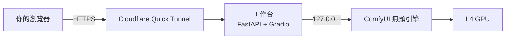

# MOSS-Image Colab Studio

在 Google Colab 的 L4 GPU 上使用 [MOSS-Image](https://github.com/OpenMOSS/MOSS-Image) 的網頁工作台。
不用操作 ComfyUI 節點，在五個分頁裡完成文生圖、海報排版、指令修圖、局部重繪與構圖控制。

[](https://colab.research.google.com/github/Openclaw-Metis/MOSS-Image-Colab/blob/main/notebooks/MOSS_Image_Colab.ipynb)

> **開發版**：所有功能都在 Colab L4 實測過，但多圖修圖 3～4 張與輪廓控制沒有通過驗收，繁中標題也可能寫錯，
> 所以還不算正式發布。詳見[已知限制](#已知限制)。

## 快速開始

需要付費 Colab 方案，且還有 compute unit 額度。

1. 點上方按鈕開啟 Notebook，執行階段選 **L4 GPU**（Notebook 已預設 L4 與高 RAM）。
2. 依序執行第 1～4 格。第一次會下載約 24.5 GB 模型，需要 10 分鐘以上。
3. 點第 4 格印出的**一次性登入連結**。連結要在 30 分鐘內點開、只能用一次；登入後同一個瀏覽器 10 小時內不用再登入。
4. 用完先下載作品或匯出專案 ZIP，再執行最後一格「停止工具」，並在 Colab 刪除執行階段，避免繼續消耗額度。

完整步驟、各分頁用法與疑難排解見[使用說明](docs/user-guide.md)。

## 功能

| 分頁 | 可以做什麼 | 驗收狀態 |
|---|---|---|
| 文生圖與排版 | 精細 50 步或加速 8 步生圖；一鍵套用常用比例；在畫布上拉框指定文字、物件與人物位置 | 通過；繁中字可能寫錯 |
| 多圖指令修圖 | 用文字指令改圖，例如「把圖 1 的外套換成圖 2 的外套」 | 1～2 張通過；3～4 張為實驗 |
| 筆刷局部重繪 | 塗出要改的範圍再描述內容；塗抹範圍外的像素原封不動 | 通過 |
| 視覺與深度控制 | 照來源圖的深度或色塊構圖，換角色或換風格 | 深度通過；輪廓限天空或遠景背景；視覺參考為實驗 |
| 模型與高解析 | 下載固定清單模型、切換 SFT／Base 主模型、加入 Hugging Face LoRA、分段放大到 2048² | 通過；自加 LoRA 未做 GPU 實測 |

專案（輸入圖、遮罩、排版、各分頁設定與作品）可匯出成 ZIP，在新的 Colab 執行階段匯入後接著編輯。

在 L4 上的實測耗時：加速 8 步約 10～15 秒、精細 50 步約 110～150 秒、修圖約 80～95 秒、分段放大到 2048² 約 520 秒
（1 MP 圖；其他項目見[使用說明](docs/user-guide.md#大約要多久)）。

## 已知限制

- **繁中字形**：實測 10 張繁中排版海報有 3 張文字出錯（「週」寫成「周」、「鬱金香」寫成「鬱花香」、框描述的「橘棕色」被寫進標題），
  未達 8/10 的目標。請逐字檢查成品，重要標題建議後製加字。（[批次 A](docs/evidence/stage2-batch-a/README.md)）
- **多圖修圖 3～4 張**：模型常沒把圖 3、圖 4 的內容帶進成品，介面標為實驗。（[批次 C](docs/evidence/stage4-6-batch-c/README.md)）
- **輪廓控制**：在棚拍或室內背景下估出的輪廓整片變白，等於沒有控制；介面預設改用深度。
- **視覺參考**：MOSS-Image 本身沒有圖片輸入，這條路徑傾向照抄參考圖，效果不保證。
- **原生大圖**：超過約 2.2 MP 的原生尺寸是實驗功能，建議先生成再分段放大。
- **資料只在 Colab 暫存磁碟**：執行階段被回收或刪除後，模型、作品與專案都會消失，請記得下載或匯出。
- **單人使用**：一次只跑一個 GPU 工作；工作台網址是公開網址，登入連結與密碼不要分享。

## 使用限制與隱私

- 不得以真人照片製作換臉、私密或冒用他人身分的內容；Colab 對所有執行環境禁止 deepfakes。
- 上傳的圖片只存在你自己的 Colab 執行階段，存檔時去除原始檔名與中繼資料；工具不會把素材上傳到其他服務。
- Hugging Face token 為選填，只從 Colab 密鑰讀取，不寫入檔案、輸出、專案或日誌。

## 驗收狀態

規格 [v1.3.0](specs/requirements.md) 的 Stage 0～10 都已完成，驗收都在 Colab L4 實跑。

- 必要驗收項目中，AC-08（多圖修圖）與 AC-11（輪廓控制）為有條件通過，其餘全部通過；兩項限制已由使用者接受，介面也已標示。
- AC-19（繁中排版）是決策關卡，7/10，使用者接受限制。
- Stage 10 依 README 在乾淨 L4 重演一次，由使用者操作並回報正常。

逐項結果見 [Stage 9 總表](docs/stages/stage9.md)；各批次的報告與縮圖在 [`docs/evidence/`](docs/evidence/)。

## 運作方式



- ComfyUI 只綁在 loopback，沒有對外入口；所有生成、上傳與下載都走需要登入的同源 HTTP，進度用輪詢，不依賴 SSE。
- 環境與模型都鎖定版本：Python 3.13.16、PyTorch 2.14.1+cu130、ComfyUI 0.44.0（`1332fab`）、Gradio 6.31.0；
  每個模型檔都校驗 SHA256（`configs/runtime.lock.json`、`configs/models.lock.json`）。
- 工作流是固定的 API 格式範本（`workflows/`），送出前會用引擎的 `object_info` 驗證。

## 模型來源

| 模型 | 大小 | 第 2 格下載 |
|---|---|---|
| SFT 主模型 | 10.16 GB | 是 |
| Qwen3.5 9B int8 文字／視覺編碼器 | 9.75 GB | 是 |
| VAE（flux2-vae_small） | 0.25 GB | 是 |
| 加速 8 步 LoRA | 1.19 GB | 是（可取消勾選） |
| 修圖 LoRA | 0.30 GB | 是（可取消勾選） |
| 色彩／深度控制 LoRA | 0.31 GB | 是（可取消勾選） |
| MoGe 3 幾何估計 | 2.50 GB | 是（可取消勾選） |
| Base 主模型 | 10.16 GB | 否；要切換主模型時到模型頁下載 |

來源都鎖定 commit，下載後校驗 SHA256：

- [Comfy-Org/MOSS-Image](https://huggingface.co/Comfy-Org/MOSS-Image/tree/2929efe3cdd506c0a430bcfca70a9a8d805cc095)：主模型、編碼器、VAE、修圖與控制 LoRA，宣告 Apache-2.0
- [lodestones/MOSS-Image-SFT-8-steps-dmd](https://huggingface.co/lodestones/MOSS-Image-SFT-8-steps-dmd/tree/f95df83b5e90ae91ea412434b3f9b7f1c8c6314f)：加速 8 步 LoRA，宣告 Apache-2.0
- [Comfy-Org/MoGe](https://huggingface.co/Comfy-Org/MoGe/tree/1484985258ba7ef45c314144fcf0e90924ffbf44)：MoGe 3，宣告 MIT

授權以提供者的模型卡為準，用途請自行確認。模型權重、使用者素材與憑證都不進版控。

上游參考：[MOSS-Image 使用指南](https://github.com/OpenMOSS/MOSS-Image/blob/main/USERGUIDE.md)、
[ComfyUI MOSS-Image 文件](https://github.com/Comfy-Org/docs/blob/main/tutorials/image/moss-image/moss-image.mdx)。

## 開發

```text
src/moss_studio/   domain（驗證）、storage（保存）、services（調度）、adapters（ComfyUI、HTTP、工作流）、ui
configs/           版本鎖、模型鎖、採樣預設（profiles）、功能狀態（capabilities.json）
workflows/         ComfyUI API 格式範本
notebooks/         Colab Notebook
scripts/           假引擎開發伺服器、GPU 批次腳本、引擎 preflight
tests/             unit、integration（CPU）與 gpu（需 L4）
```

CPU 測試與 lint（Linux／macOS）：

```bash
python -m venv .venv
.venv/bin/python -m pip install -r requirements-dev.lock
.venv/bin/python -m pip install -e ".[ui]"
.venv/bin/pytest -q
.venv/bin/ruff check src tests scripts
```

Windows 改用 `.venv\Scripts\python.exe` 執行相同指令；依賴 Linux `/proc` 或符號連結權限的測試會在 Windows 跳過。

不接 GPU 檢查介面：假引擎會產生標明「非模型輸出」的佔位圖，只能看介面流程，不能當成 GPU 或畫質證據。

```bash
python scripts/dev_server.py --data-root .runtime/dev --port 7861
```

Notebook 從 GitHub 取程式（第 1 格預設 `main`），本機修改要推送後 Colab 才會用到。
GPU 批次腳本與驗收流程見 [todo.md](todo.md)；交接狀態見 [DEVNOTE.md](DEVNOTE.md)。

## 文件

- [使用說明](docs/user-guide.md)：啟動、五個分頁、耗時、專案、結束、疑難排解、隱私
- [規格 v1.3.0](specs/requirements.md)：需求、架構與 AC-01～20 驗收條件
- 階段紀錄：[Stage 0](docs/stages/stage0.md)、[Stage 1](docs/stages/stage1.md)、[Stage 2](docs/stages/stage2.md)、
  [Stage 3～8](docs/stages/stage3-8.md)、[Stage 9](docs/stages/stage9.md)、[Stage 10](docs/stages/stage10.md)
- [相容性](docs/compatibility.md)：實測環境、參數來源與 GPU 驗收後的調整

## 授權

本倉庫的程式碼與文件以 [Apache License 2.0](LICENSE) 授權。
模型權重不在本倉庫內，各自依提供者的授權（見[模型來源](#模型來源)）；
ComfyUI 等執行時才下載的第三方軟體，也依它們各自的授權。
